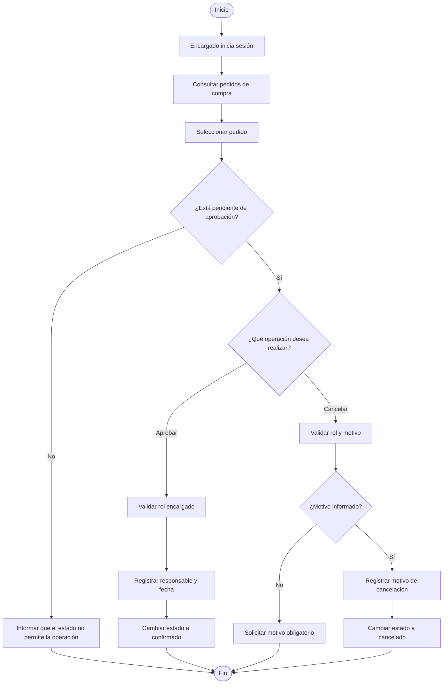
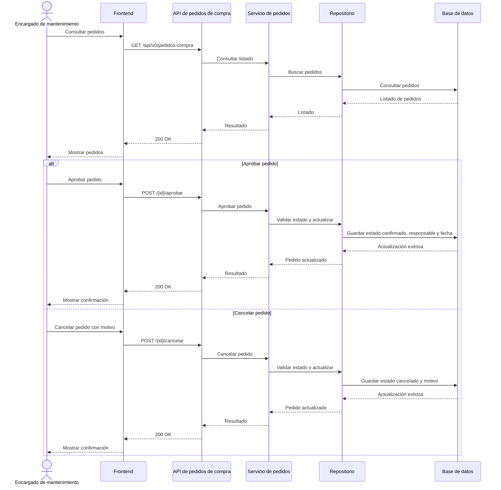

# CU: Aprobar o cancelar un pedido de compra

## Identificación
- **ID**: CUN-03
- **Objetivo**: Permitir que el encargado de mantenimiento revise, apruebe o cancele pedidos de compra, manteniendo la trazabilidad de las decisiones
- **Prioridad**: Alta
- **Actor principal**: Encargado de mantenimiento
- **Actores secundarios**: Gerencia (consulta de pedidos), Sistema

## Precondiciones
- El encargado de mantenimiento está autenticado.
- El usuario tiene el rol encargado de mantenimiento.
- Existe un pedido de compra registrado.
- El pedido se encuentra en estado `pendiente_aprobacion` para poder aprobarlo o cancelarlo.

## Postcondiciones (éxito)
- Si se aprueba, el pedido cambia al estado `confirmado`.
- Si se cancela, el pedido cambia al estado `cancelado`.
- La cancelación queda registrada con su motivo.
- La aprobación registra el responsable y la fecha de aprobación.
- Los cambios quedan persistidos en la base de datos.

## Escenario principal: aprobar un pedido
1. El encargado de mantenimiento ingresa al módulo **Pedidos de compra**.
2. El sistema muestra los pedidos disponibles.
3. El encargado selecciona un pedido en estado `pendiente_aprobacion`.
4. El encargado solicita aprobar el pedido.
5. El sistema valida el rol y el estado actual del pedido.
6. El sistema registra la aprobación, el responsable y la fecha.
7. El sistema cambia el estado del pedido a `confirmado`.
8. El sistema informa que la operación fue exitosa.

## Escenario alternativo: cancelar un pedido
1. El encargado selecciona un pedido en estado `pendiente_aprobacion`.
2. Solicita cancelar el pedido.
3. Ingresa el motivo de la cancelación.
4. El sistema valida el rol, el estado y que el motivo no esté vacío.
5. El sistema registra el motivo de cancelación.
6. El sistema cambia el estado a `cancelado`.
7. El sistema informa que la operación fue exitosa.

## Escenario alternativo: consulta por gerencia
1. Un usuario con rol gerencia ingresa al módulo **Pedidos de compra**.
2. El sistema permite consultar el listado y el detalle de los pedidos.
3. El sistema no permite aprobar ni cancelar pedidos.

## Excepciones

| Paso | Excepción | Respuesta del sistema |
| --- | --- | --- |
| 1 | Usuario no autenticado | Rechaza la solicitud con HTTP 401 |
| 5 | Usuario sin permisos para aprobar o cancelar | Rechaza la operación con HTTP 403 |
| 5 | El pedido no existe | Informa que no se encontró el pedido (HTTP 404) |
| 5 | El pedido no está en estado `pendiente_aprobacion` | Rechaza la transición con HTTP 409 y conserva el estado actual |
| 4 del escenario alternativo | El motivo de cancelación está vacío | Rechaza la solicitud con HTTP 422 |
| 6 | Se produce un error durante la persistencia | Informa el error y no debe confirmar una transición incompleta |

## Diagrama de actividad

## Diagrama de secuencia

## Reglas de negocio relacionadas

- **Transiciones de estado**: un pedido en `pendiente_aprobacion` puede pasar a `confirmado` mediante aprobación o a `cancelado` mediante cancelación.
- **Autorización**: únicamente el encargado de mantenimiento puede asignar, revisar, aprobar y cancelar pedidos. Gerencia tiene permisos de consulta.
- **Motivo de cancelación**: cancelar un pedido requiere informar un motivo.
- **Trazabilidad**: la aprobación registra responsable y fecha; la cancelación registra el motivo.
- **Integridad**: una operación no puede ejecutarse si el pedido no existe o su estado no permite la transición.

## Criterios de aceptación

- Un encargado de mantenimiento puede consultar pedidos de compra.
- Un encargado puede aprobar un pedido en estado `pendiente_aprobacion`.
- Después de aprobarlo, el estado queda en `confirmado`.
- Un encargado puede cancelar un pedido en estado `pendiente_aprobacion` indicando un motivo.
- Después de cancelarlo, el estado queda en `cancelado` y el motivo queda registrado.
- No se puede aprobar ni cancelar un pedido que no esté en `pendiente_aprobacion`.
- Gerencia puede consultar pedidos, pero no aprobarlos ni cancelarlos.
- Los usuarios sin autenticación reciben HTTP 401.
- Los usuarios sin permisos reciben HTTP 403.
- Los pedidos inexistentes producen HTTP 404.
- Las transiciones inválidas producen HTTP 409.
- La cancelación sin motivo produce HTTP 422.