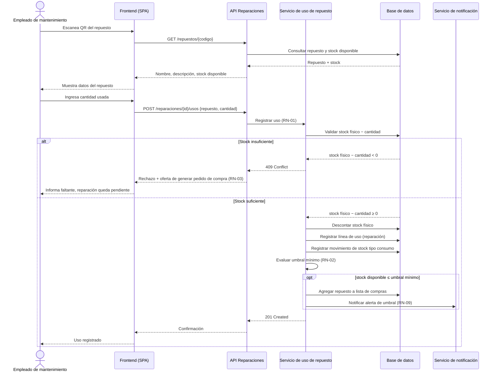

# CU: Registrar uso de repuesto en una reparación

## Identificación
- **ID**: CUN-01
- **Objetivo**: Descontar del stock los repuestos usados en una reparación, dejando registrada la trazabilidad de ese uso
- **Prioridad**: Alta
- **Actor principal**: Empleado de mantenimiento
- **Actores secundarios**: Sistema de notificación (correo), Encargados (reciben alerta si aplica)

## Precondiciones
- El empleado está autenticado con rol Empleado de mantenimiento
- Existe una incidencia en estado En reparación asociada a la máquina
- El repuesto existe en el sistema con un código QR

## Postcondiciones (éxito)
- El stock físico del repuesto quedó descontado en la cantidad usada
- Se creó una línea de uso vinculada a la reparación
- Se generó un movimiento de stock tipo consumo
- Si el stock disponible resultante quedó ≤ umbral mínimo se disparó la alerta y el repuesto entró en la lista de compras

## Escenario principal
1. El empleado escanea el código QR del repuesto
2. El sistema muestra nombre, descripción y stock disponible
3. El empleado ingresa la cantidad usada
4. El sistema valida stock físico − cantidad
5. El sistema descuenta el stock físico
6. El sistema registra la línea de uso asociada a la reparación/incidencia
7. El sistema evalúa el umbral mínimo y genera alerta si corresponde

## Escenario alternativo — falta de stock
Paso 4, si stock físico − cantidad < 0:
- El sistema rechaza la operación
- Informa al empleado el faltante
- Le ofrece generar un pedido de compra, derivando al CU "Generar pedido de compra" (RN-03)
- La reparación queda pendiente de ese repuesto

## Excepciones

| Paso | Excepción | Respuesta del sistema |
| --- | --- | --- |
| 1 | El código QR escaneado no corresponde a ningún repuesto registrado | Informa "repuesto no encontrado" y no avanza al paso 2 |
| 3 | La cantidad ingresada es ≤ 0 o no es un número entero | Rechaza el ingreso y pide una cantidad válida (RN-01 exige `cantidad ≥ 1`) |
| 2-6 | La incidencia asociada no está en estado `En reparación` (precondición incumplida) | Rechaza la operación e informa que la incidencia debe estar en reparación para registrar usos |
| 5 | Dos empleados intentan descontar la última unidad del mismo repuesto al mismo tiempo | **Fuera de alcance de este CU.** Es un hueco deliberado del dominio (sección 7) y queda como requisito explícito de concurrencia para M4, resuelto con un ADR |

## Diagrama de actividad

```mermaid
flowchart TD
    Inicio([Inicio]) --> Escanear[Empleado escanea QR del repuesto]
    Escanear --> Existe{¿Repuesto existe?}
    Existe -- No --> ErrorRepuesto[Informar "repuesto no encontrado"]
    ErrorRepuesto --> Fin([Fin])
    Existe -- Sí --> Mostrar[Mostrar nombre, descripción y stock disponible]
    Mostrar --> Ingresar[Empleado ingresa cantidad usada]
    Ingresar --> CantidadValida{¿Cantidad entera ≥ 1?}
    CantidadValida -- No --> ErrorCantidad[Rechazar y pedir cantidad válida]
    ErrorCantidad --> Ingresar
    CantidadValida -- Sí --> Validar["Validar stock físico − cantidad (RN-01)"]
    Validar --> HayStock{"¿Resultado ≥ 0?"}
    HayStock -- No --> Rechazar[Rechazar operación e informar faltante]
    Rechazar --> Ofrecer["Ofrecer generar pedido de compra (RN-03)"]
    Ofrecer --> Pendiente[Reparación queda pendiente de ese repuesto]
    Pendiente --> Fin
    HayStock -- Sí --> Descontar[Descontar stock físico]
    Descontar --> Linea[Registrar línea de uso de la reparación]
    Linea --> Movimiento[Generar movimiento de stock tipo consumo]
    Movimiento --> Umbral{"¿Stock disponible ≤ umbral mínimo? (RN-02)"}
    Umbral -- Sí --> Alerta[Generar alerta y agregar repuesto a lista de compras]
    Alerta --> Historia[Actualizar historia del repuesto, RN-06]
    Umbral -- No --> Historia
    Historia --> Fin
```

## Diagrama de secuencia



## Reglas de negocio relacionadas

- **RN-01 — Descuento por uso.** Usar un repuesto en una reparación descuenta del stock físico la cantidad de la línea de uso. El stock físico resultante debe ser ≥ 0: si no alcanza, el uso se rechaza.
- **RN-02 — Umbral.** Cuando el stock disponible resultante queda ≤ umbral mínimo, se genera la alerta y el repuesto entra en la lista de compras.
- **RN-03 — Faltante → compra.** Si no hay stock disponible para una solicitud, el empleado lo reporta y puede generar un pedido de compra.
- **RN-06 — Trazabilidad.** El movimiento de stock y la línea de uso quedan vinculados a la reparación, para poder reconstruir la historia interna del repuesto (pedido → recepción → uso).
